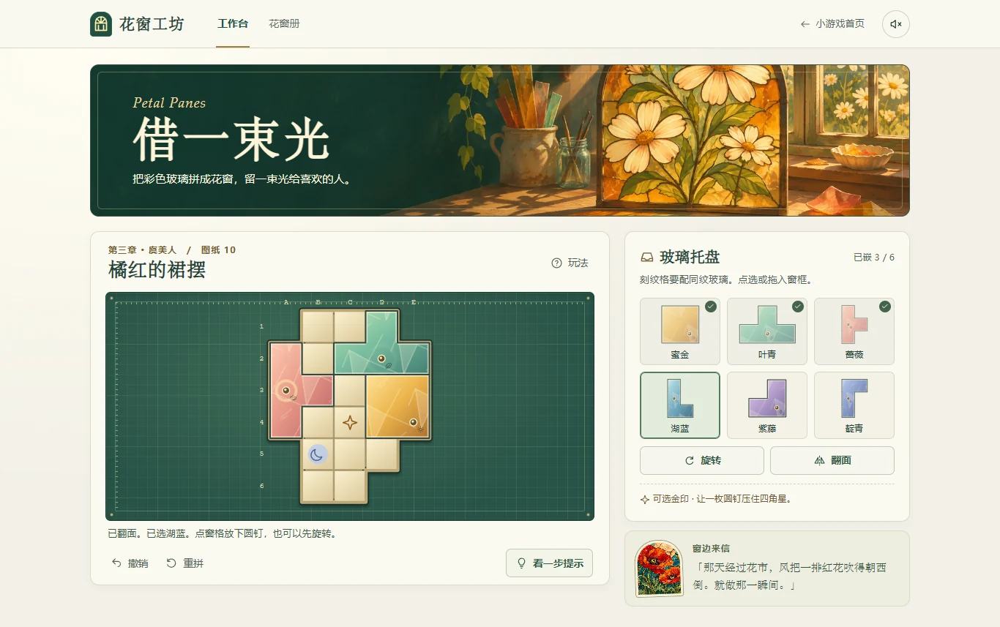

# 女友小游戏

`index.html` 是「隔空拍脸」的入口。点击头像即可玩，也可以开启摄像头，让漫画手掌跟随手部动作挥拍。

默认头像是发布时提供的照片。游玩时临时更换的照片只在当前页面使用。摄像头画面在浏览器内处理，切换到其他标签页时会关闭摄像头。素材、手部识别模型和运行时包含在站点里。

## GitHub Pages

将解压后的内容提交到目标仓库的发布分支根目录。在仓库 **Settings → Pages** 选择 **Deploy from a branch**，选对应分支和 **/(root)**。访问 GitHub Pages 提供的 HTTPS 地址使用摄像头。网页及资源路径支持发布在仓库子路径下。

本地开发也可以在该目录运行 `python -m http.server 8000`，然后访问 `http://localhost:8000/`。

## 借一束光 · 花窗工坊

从首页进入[花窗工坊](./bloom-glass/index.html)，把带圆钉的异形玻璃嵌进窗框。《四时同窗》的四章十六张图纸依次加入可选金印、同纹刻槽、翻面与固定铅条。每完成一张试片，对应的花窗插画就点亮四分之一。花窗册可以选关、重读回信，也有按设备本地日期生成的每日图纸。

续篇增加三章十二张图纸。旧站的铃兰要求玩家把玻璃背面的实心花对准空心拓印。到紫藤桥，要让指定的两朵花心在相邻两格接成藤枝，后面还会遇到一朵接两头的花。桂花巷的四张图纸各有两个信位，玻璃的落点决定收到哪封回信，八封都可以收进花窗册。[直接进入《花窗背面的信》](./bloom-glass/index.html#afterlight)

续篇工作台的「透光试摆」可以先选格，再旋转、翻面，点「嵌入此处」才会放下玻璃。每张新图纸都有一条手写思路。想读另一封回信时，可以指定提示要找的信位，再拼一次。原版存档与续篇共用同一本花窗册。

点选托盘里的玻璃，再点窗格放下圆钉，也可以直接拖放。点已嵌的玻璃可以取回。数字键选片、方向键选格、空格或回车嵌入，R 旋转，F 翻面，Z 撤销。一步提示会从当前拼法继续，遇到死局时会指出先取回哪片。拼图进度、撤销记录、金印和音效设置保存在当前浏览器里。

花窗工坊采用原生 HTML、CSS 和 JavaScript，插画随仓库提供。用 Node.js 18 及以上运行 `node --test tests/bloom-glass.test.mjs` 可验证关卡、提示和每日图纸。

## 实现

- `assets/game.js` 处理头像、分数和打击动画。
- `assets/camera.js` 处理相机权限、MediaPipe 推理和手部位置投影。
- `assets/hand-model.js` 根据手部节点绘制手掌轮廓、手指和光影。
- `assets/swipe.js` 根据掌心移动速度及轨迹与头像的接触判断挥拍。
- `assets/vision/` 包含 Google MediaPipe Tasks Vision 0.10.14、Hand Landmarker Float16 v1 模型及运行时代码的 Apache 2.0 许可文本。
- `assets/sound.js` 提供音效开关和打击音效。
