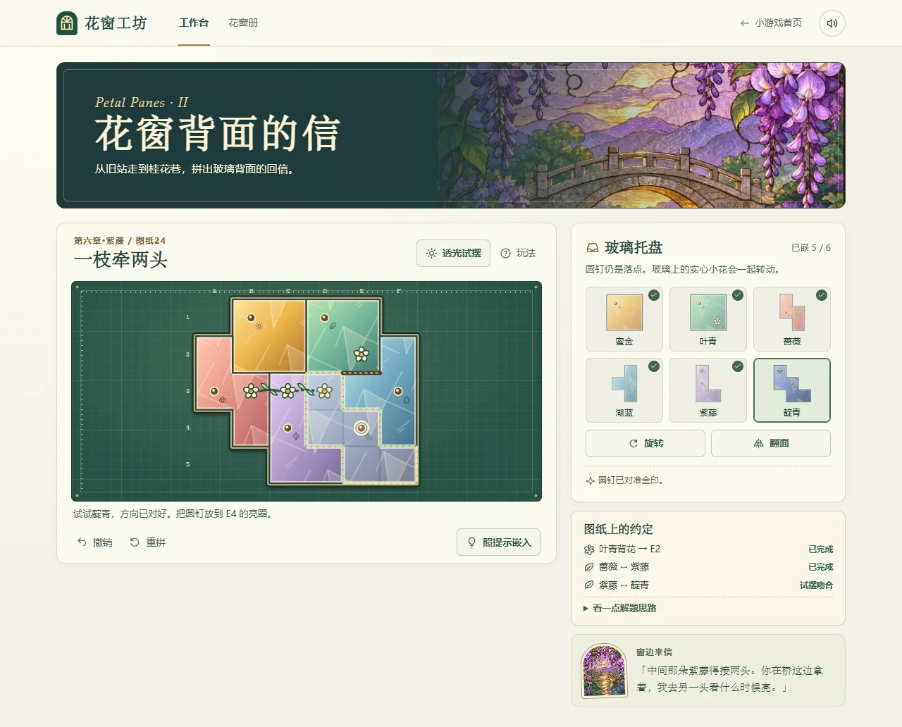
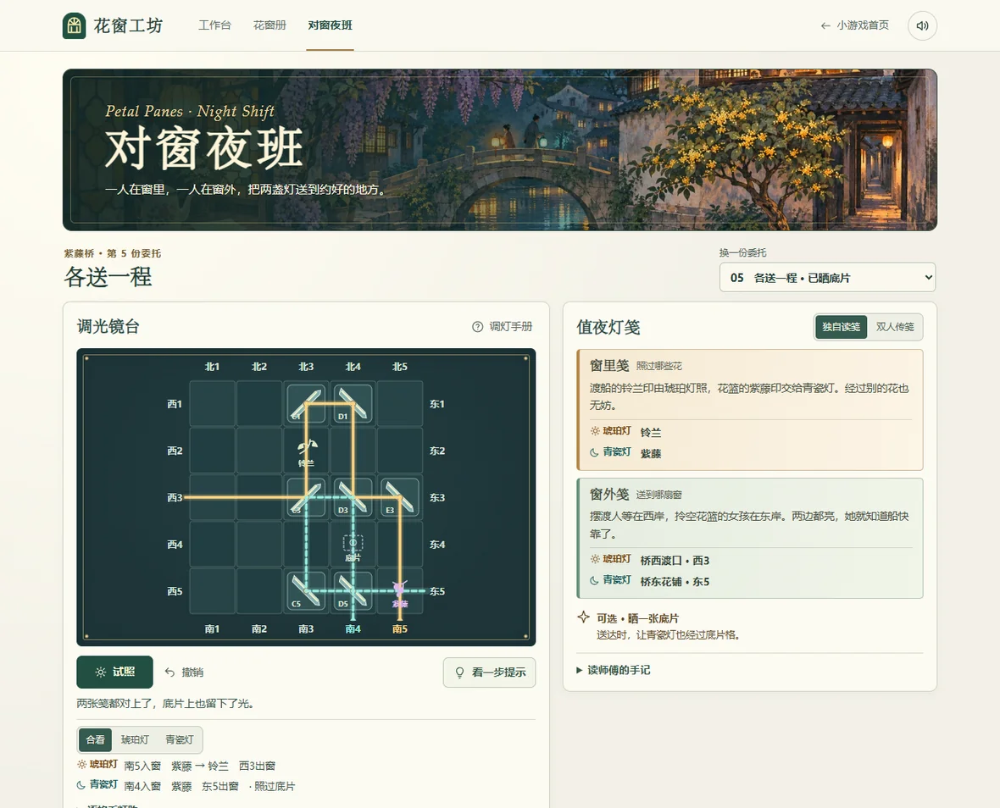
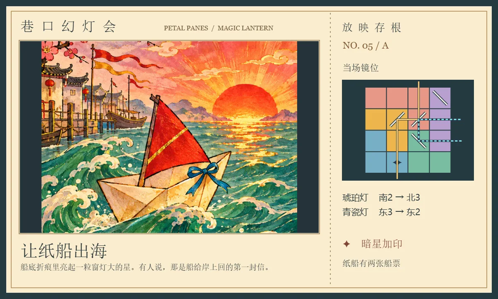
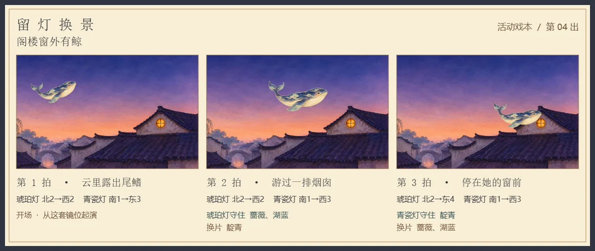
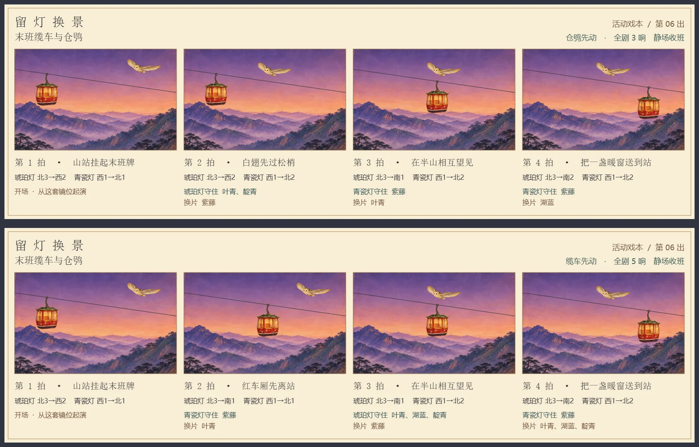
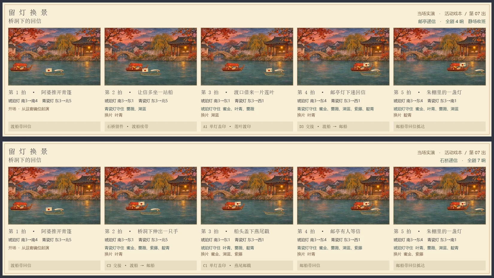
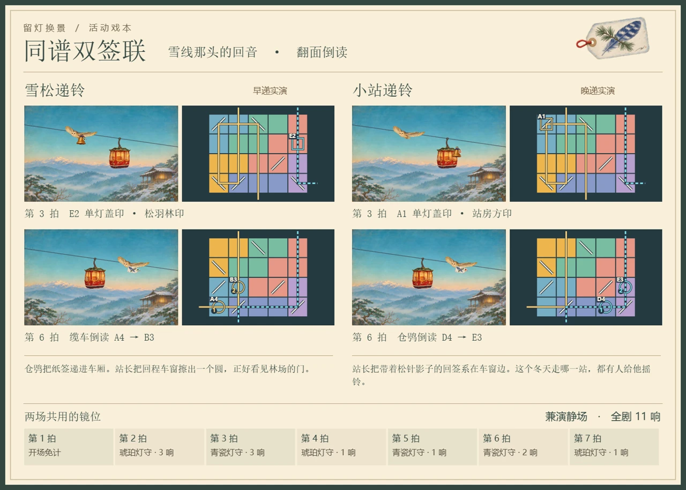
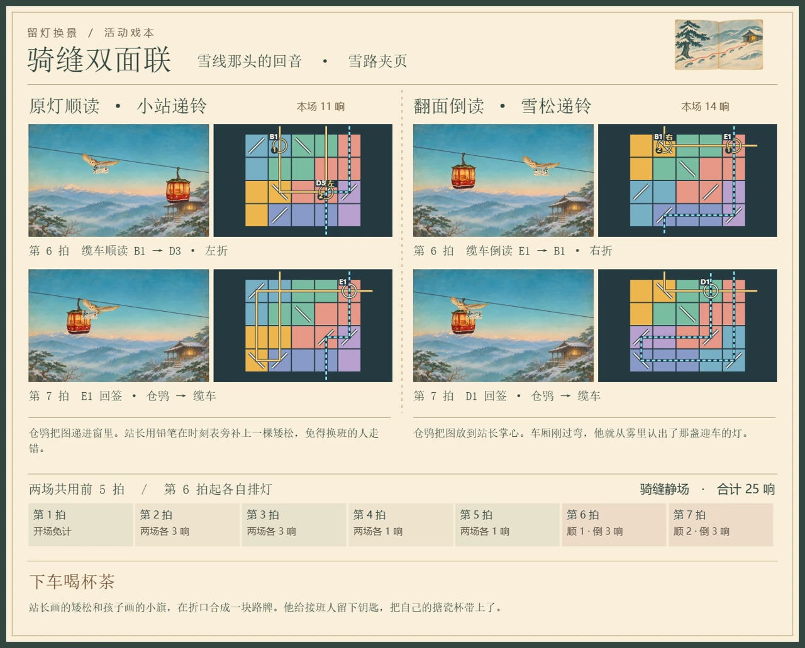
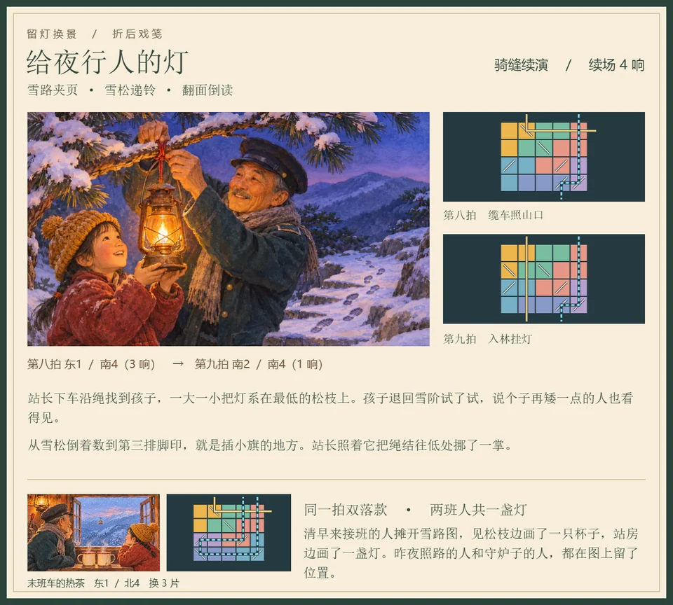
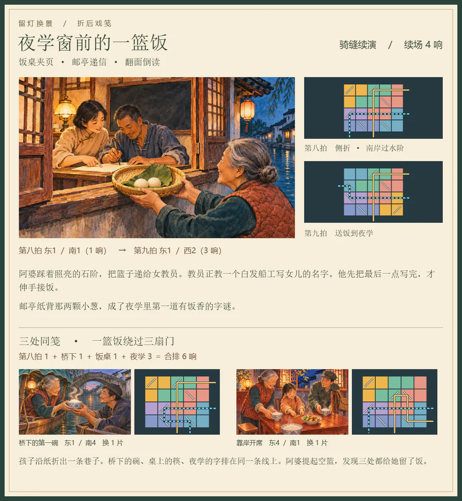

# 女友小游戏

`index.html` 是「隔空拍脸」的入口。点击头像即可玩，也可以开启摄像头，让漫画手掌跟随手部动作挥拍。

默认头像是发布时提供的照片。游玩时临时更换的照片只在当前页面使用。摄像头画面在浏览器内处理，切换到其他标签页时会关闭摄像头。素材、手部识别模型和运行时包含在站点里。

## GitHub Pages

将解压后的内容提交到目标仓库的发布分支根目录。在仓库 **Settings → Pages** 选择 **Deploy from a branch**，选对应分支和 **/(root)**。访问 GitHub Pages 提供的 HTTPS 地址使用摄像头。网页及资源路径支持发布在仓库子路径下。

本地开发也可以在该目录运行 `python -m http.server 8000`，然后访问 `http://localhost:8000/`。

## 借一束光 · 花窗工坊

从首页进入[花窗工坊](./bloom-glass/index.html)，把带圆钉的异形玻璃嵌进窗框。《四时同窗》的四章十六张图纸依次加入可选金印、同纹刻槽、翻面与固定铅条。每完成一张试片，对应的花窗插画就点亮四分之一。花窗册可以选关、重读回信，也有按设备本地日期生成的每日图纸。

续篇增加三章十二张图纸。旧站的铃兰要求玩家把玻璃背面的实心花对准空心拓印。到紫藤桥，要让指定的两朵花心在相邻两格接成藤枝，后面还会遇到一朵接两头的花。桂花巷的四张图纸各有两个信位，玻璃的落点决定收到哪封回信，八封都可以收进花窗册。[直接进入《花窗背面的信》](./bloom-glass/index.html#afterlight)

续篇工作台的「透光试摆」可以先选格，再旋转、翻面，点「嵌入此处」才会放下玻璃。每张新图纸都有一条手写思路。想读另一封回信时，可以指定提示要找的信位，再拼一次。原版存档与续篇共用同一本花窗册。

点选托盘里的玻璃，再点窗格放下圆钉，也可以直接拖放。点已嵌的玻璃可以取回。数字键选片、方向键选格、空格或回车嵌入，R 旋转，F 翻面，Z 撤销。一步提示会从当前拼法继续，遇到死局时会指出先取回哪片。拼图进度、撤销记录、金印和音效设置保存在当前浏览器里。

### 番外 · 对窗夜班

打烊后，花窗工坊还要帮街坊调灯。八份委托从旧站茶亭走到桂花巷。窗里笺写着灯要经过的花纹和先后，窗外笺记着等灯的人和出口。一个人可以摊开两张笺，两个人可以在同一部手机上分别拆笺，合上后交换线索。[进入对窗夜班](./bloom-glass/index.html#nightshift)

点镜片改变朝向，点「试照」查看光经过哪些花、从哪里出窗。两盏灯共用同一套镜片。到桂花巷还会遇到铜轴，圈号相同的两面镜会一起转。可以单看一束光，逐格回看它从哪边入镜、往哪边走。

每交一班，值夜相册的街景就显影一段。后七份委托另有银盐底片，要找到一条途经底片格、同时满足两张笺的灯路。回条和底片细节都可以在相册里重读。

### 夜班连拍 · 快门之间

六卷胶片各拍两帧或三帧，共十五幅分镜。开场可以自由调镜，按下快门以后，下一帧要沿用手里的镜位。两帧间最多改一两根轴，转回原位会腾出名额。封蜡的镜片要保持上一帧的朝向。可以从夜班直接选「连拍」，也可以在手机上各拿一张灯笺商量下一帧。[进入《快门之间》](./bloom-glass/index.html#shutters)

《花篮离岸的三瞬》从解绳、接篮一直拍到船离开桥洞。有些摆法能连续拍好前两张，却赶不上第三张。提前翻分镜可以开一张草稿，在同样的封蜡和换帧限额下试调。第二帧试照合格并记下后，还能接着试第三帧。正式拍到相同的上一帧镜位，就能采用草稿。「预演后续」可以核对后面是否走得通，整卷提示会指出最晚需要从哪一帧重拍。

每按一次快门就显出一张插画。后五卷各有一句照片背面的题字，用最少的帧间调镜次数拍完即可读到。底片册保存每卷的最佳灯路，可以逐帧回放当时的镜位和光路，看清两张照片之间究竟动过哪些轴。

### 巷口幻灯会

工作台上可以切换到外公的放映棚。六场节目各有一套带银镜的异形玻璃。先把窗框拼满，再让光沿镜面转向，走到场记里的出口。梨花和月亮画在两张片上，还得让两束光在合像圈里一横一竖穿过，才能把月亮挂回树梢。[进入《巷口幻灯会》](./bloom-glass/index.html#lantern)

第五场的红帆纸船可以出海，也可以回到码头。末场可以把灯送给幕前的观众，也可以转向幕后交接玻璃的两双手。试灯能单看一束光，透光试摆能在落片前预演。场记可以指定提示寻找哪一幕或哪颗暗星，开场时实际走通的光路决定演什么。

戏票夹可收八幅幕景，后七幅各有一行暗星加印。翻票能看当场的镜位，收齐同场的两种结局后还能对照换过的玻璃。每张票都可将幕景和实拼光路一起存为 PNG。

### 活动片 · 留灯换景

四出新节目让一张玻璃上的角色在固定布景前移动。桥头的纸燕和街角的电车各演两拍，河湾的荷灯与阁楼窗外的云鲸各演三拍。每次换景都要留一盏灯照着原处。这束光在上一拍实际经过的整片玻璃都会被夹住。可以取回其他玻璃，转面、交换位置，逐拍把戏接下去。[进入《留灯换景》](./bloom-glass/index.html#slips)

电车进站时要真挪两片玻璃。荷灯转弯后，要从守琥珀灯换成守青瓷灯。「叠看上拍」会描出移走玻璃的轮廓和银镜，按原样放回来就能腾出换片名额。「探后场」能看出眼前的拼法能否一路接到选定的结尾。已经落片又接不下去时，一步提示会指出最晚该从哪一拍改起。

云鲸可以停在孩子窗前，也可以陪她游向天明。选「按观众点戏排演」，提示会帮你寻找能通向两个结尾的中场。用相同的开场和中场镜位演完两个结尾，阁楼上的孩子就会送来一张点戏签。翻开它，可以从鲸游过烟囱的那一刻亲自点演。五本活动戏本都可以拉动玻璃重映、翻看当场的镜位，或导出一张连景长票 PNG。

#### 双片合演

第五出《两只船的一封信》演三拍，第六出《末班缆车与仓鸮》演四拍。每盏灯各管一张透明角色片。邮船先开，就守住照着渡船的青瓷灯。等渡船要靠近，再把已到位的邮船留在原处。开场落片前可用「探后场」看当前的镜位支持谁先动。试灯时，幕上的两个角色会分别跟着自己的出光口显现。[进入双片合演](./bloom-glass/index.html#duets)

想拿静场收班笺，就得替整出戏省换片。开场免计，往后每落一拍，镜位改变的每片玻璃记一响。开着音效，还能听到这些玻璃按各自的音高轻敲一声。《末班缆车与仓鸮》里，仓鸮先飞可以三响收场，缆车先走则要五响。照常演完同样能收戏本。想改排时，工坊会留下还能接到静场的前几拍。

每种先手都保留换片最少的一次实演。收齐一出戏的两种先手后，用同一根拉杆并排播放，可以在同一拍翻看两套镜位、守灯和换片记录，也能导出整场的双幕对照票。

#### 递物返场

第七出《桥洞下的回信》和第八出《把铃声送过雪线》各有五拍。阿婆可以在石桥把信递给邮差，也可以带它到邮亭，自己盖一枚莲叶渡印。山站的旧铜铃可以由仓鸮在雪松接走，也可以随缆车到小站，带走一张盖着建站年份的铃签。第二拍落片前都能改站。[进入递物返场](./bloom-glass/index.html#relay)

递物时，两束光须在标出的交接眼一横一竖地直穿。第三拍由当时持物的角色盖印，只能让它的灯照到自己的印位。开启「试灯」能核对交接眼和印位。「探后场」会根据眼前的拼法算出全剧最低响数，以及本拍之后还得换多少片。

想让同一套镜位兼演早递和晚递，可以勾「排一谱两印」。邮亭晚递最低四响能收场，两印底谱至少六响。底谱会独立留存，拉动重映的拉杆能并排看同一刻谁持信、谁盖印。分别亲手演完两条路线，还能导出两场实演的双幕交接联。

#### 七拍回执与同谱合签

第九出《一张回到渡口的签条》把一句「饭还热着」捎回阿婆手里。第十出《雪线那头的回音》把孩子挂好门铃的消息送回小站。可以直接开场，也可以翻出已演过的五拍，点「沿这五拍续演回执」。工坊会留下还能接到回程的镜位。[进入回执与合签](./bloom-glass/index.html#receipts)

第三拍由谁盖印，第六拍就由谁举起原灯，从入口依次照过回签上的两个透孔。选「翻面倒读」，则交给搭档，从另一盏灯的出口循光读回去。第七拍还要找一处十字交光，把回签递还给最初出发的人。在渡口，即使第五拍幕上的船停在同一处，船下两套不同的镜位也可能各自只通一种读法。落片前点「探后场」可以先看两条回路。

想用同一张底谱演早递和晚递，可以一起勾选「排一谱两印」和静场目标。《雪线那头的回音》顺读时，两场分开排都能用十一响收场，同谱兼演要十二响。翻面倒读，十一响就能兼演。拿到底谱后，点「照底谱实演另一印」，逐拍翻看底稿、对齐玻璃，再亲手落片。两场镜位都合上，戏本才会收下「同谱双签联」。票上并排印出两场的盖印、读孔光路和共用的七拍换片记录。已有的五拍底谱也可以合签。

#### 夹页与骑缝联

阿婆的信里夹了一张饭桌图，林场孩子的铃签里藏了一张雪路图。正文和夹页都能在两站交接、从两面读，共有十六条七拍路线。进第六拍前选好纸页和读法。读夹页时，光要依次照过两孔，还要在第二孔顺着折痕左转或右转。倒读的左右手以从出口往回走的方向为准。点「沿光逐格验纸」可以拖动游标，在实际镜位上走到第二孔，或换另一枚印来看。[展开夹页](./bloom-glass/index.html#folds)

想把正反两面的故事拼在一起，可以点「排骑缝合签」。第一场给对面留路，第二场换站、翻面，亲手照演共同的前几拍。到了折口，就能沿另一条灯路自己排下去。在渡口，正文最多共用三拍，饭桌夹页可以共用五拍。在山站的雪路夹页，小站顺读配雪松倒读，两场合计最低二十五响。换成雪松顺读配小站倒读，就要二十六响。勾选「按两场最低合计排演」可以挑战这两个目标。

每种配对都有一段合签后才能读全的回信。戏本可收八张骑缝联，能用拉杆对照共谱末拍、两场开始分开排灯的那一拍，以及第六拍的双孔验印。导出的纸联印着各自读到的折向、回签归还时的光路和两场合计响数。已有的七拍戏本只要镜位相合，也能拿来合签。

#### 折后两拍

回签到了手里，饭还热着，末班车也还没开。饭桌和雪路的骑缝联都能从第二场的第七拍往下演。第八拍选由谁守灯，拨动其余玻璃的银镜。第九拍可以把光带回原处，也可以在另一处会合。桥下递饭、靠岸开席、回站喝茶和入林挂灯各有一幅结局画。孩子、阿婆和站长会在笺边留字，交接的站点和正倒读法都会改变这行落款。[直接试玩折后两拍](./bloom-glass/index.html#tails)

雪路倒读时，仓鸮巡松径可以两响回站。换缆车照山口，在第八拍花三响把两条路都留下，第九拍便能一响去挂灯，或三响回站喝茶。饭桌的某些顺读底稿只能沿渡船走。想让邮船照桥洞，可以保留原来前六拍，重排第七拍的回签镜位。骑缝第二场落回签前也可以对照能给第八拍留路的镜位。

从同一张联、同一套第八拍镜位分别演完两个结局，会收下一份「同一拍双落款」。可以翻读两段结局、并排核对三套实演镜位，或把它们印在同一张戏笺上。上一版签好的联可直接续演。第一次来也可以借谱，从两拍小戏开始。

#### 侧折点戏与三处同笺

饭桌图的纸角藏着一扇夜学的窗，雪路图的背坡还有一座等平安信的望哨。第八拍选「侧折纸角」，饭桌可以走南岸水阶或柳巷，雪路可以绕望哨背坡或沿林缘递信。第九拍多了《夜学窗前的一篮饭》和《望哨回了三声铃》。也可以翻回原折，看看先前留下的镜位能否照到新去处。[直接试玩侧折点戏](./bloom-glass/index.html#sidefold)

先挑两处想读的落款，再试哪套镜位能同时留住它们。一张顺读饭桌谱在南岸水阶单送夜学只需四响。想让饭桌也开席，可以在第八拍换两片玻璃，留住这一拍，一响开席、三响送夜学，合排六响。改走柳巷，同一张谱可以省到五响。雪路倒读沿林缘递信时，第八拍同样花三响，两套镜位都能六响合演松径和望哨，一套把一响留给挂灯，另一套把一响留给报平安。

每张夹页有三种双落款，各自合出一封不同的信。饭桌和夜学合读《把名字写进座次》，松径和望哨合读《从低枝到高窗》。留着原来的第八拍，亲手把三个去处都演完，还能收《一篮饭绕过三扇门》或《夜班交接簿》。合笺可以翻回任意一对，也能导出共同的第八拍、各自的第九拍和合排响数。

花窗工坊采用原生 HTML、CSS 和 JavaScript，插画随仓库提供。用 Node.js 18 及以上在仓库根目录运行 `node --test` 可验证故事图纸、每日图纸、灯路、连拍规划、幻灯幕景、活动片的换景顺序、交接与盖印、双孔读序与折向、两场共谱的拍数和最低响数，以及戏本存档恢复。

## 实现

- `assets/game.js` 处理头像、分数和打击动画。
- `assets/camera.js` 处理相机权限、MediaPipe 推理和手部位置投影。
- `assets/hand-model.js` 根据手部节点绘制手掌轮廓、手指和光影。
- `assets/swipe.js` 根据掌心移动速度及轨迹与头像的接触判断挥拍。
- `assets/vision/` 包含 Google MediaPipe Tasks Vision 0.10.14、Hand Landmarker Float16 v1 模型及运行时代码的 Apache 2.0 许可文本。
- `assets/sound.js` 提供音效开关和打击音效。
