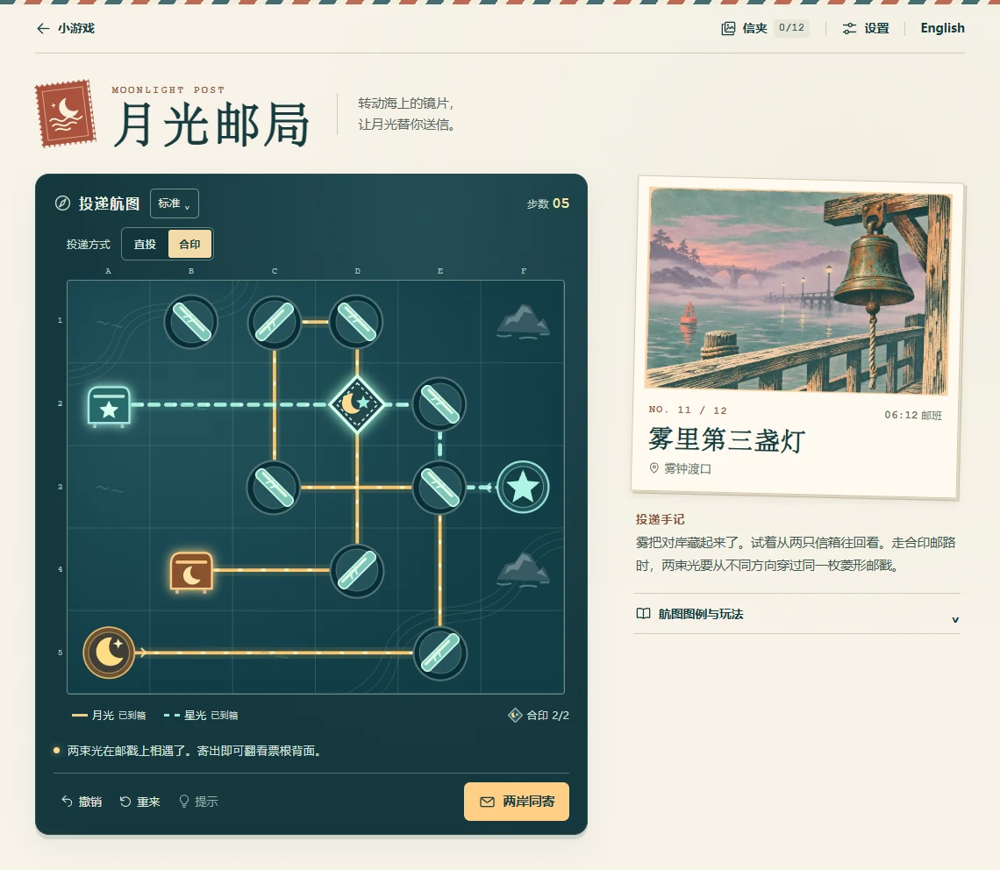

# 女友小游戏

`index.html` 是「隔空拍脸」的入口。点击头像即可玩，也可以开启摄像头，让漫画手掌跟随手部动作挥拍。

默认头像是发布时提供的照片。游玩时临时更换的照片只在当前页面使用。摄像头画面在浏览器内处理，切换到其他标签页时会关闭摄像头。素材、手部识别模型和运行时包含在站点里。

## 月光邮局

从首页顶部点「月光邮局」，或打开 [月光邮局](./moon-mail/index.html)。转动海上的圆镜，让同一束月光经过沿途的星形邮戳、照到收信箱，再点「寄出月光」拆信。六封信从白沙灯塔一直寄到晨光窗台，中途会遇到礁石和成对的潮门。

点击镜片或用 Tab 选中后按空格、回车即可旋转。可以随时撤销、重来或查看一步提示。「明信片夹」可以选关、重读和重玩。已送达的明信片支持改写寄语并导出 PNG。当前路线、最佳步数和寄语保存在当前浏览器，插画随站点提供。

在仓库根目录运行 `node --test tests/moon-mail.test.mjs` 可验证全部关卡的光路与提示（Node.js 18 及以上）。

## GitHub Pages

将解压后的内容提交到目标仓库的发布分支根目录。在仓库 **Settings → Pages** 选择 **Deploy from a branch**，选对应分支和 **/(root)**。访问 GitHub Pages 提供的 HTTPS 地址使用摄像头。网页及资源路径支持发布在仓库子路径下。

本地开发也可以在该目录运行 `python -m http.server 8000`，然后访问 `http://localhost:8000/`。

## 实现

- `assets/game.js` 处理头像、分数和打击动画。
- `assets/camera.js` 处理相机权限、MediaPipe 推理和手部位置投影。
- `assets/hand-model.js` 根据手部节点绘制手掌轮廓、手指和光影。
- `assets/swipe.js` 根据掌心移动速度及轨迹与头像的接触判断挥拍。
- `assets/vision/` 包含 Google MediaPipe Tasks Vision 0.10.14、Hand Landmarker Float16 v1 模型及运行时代码的 Apache 2.0 许可文本。
- `assets/sound.js` 提供音效开关和打击音效。
