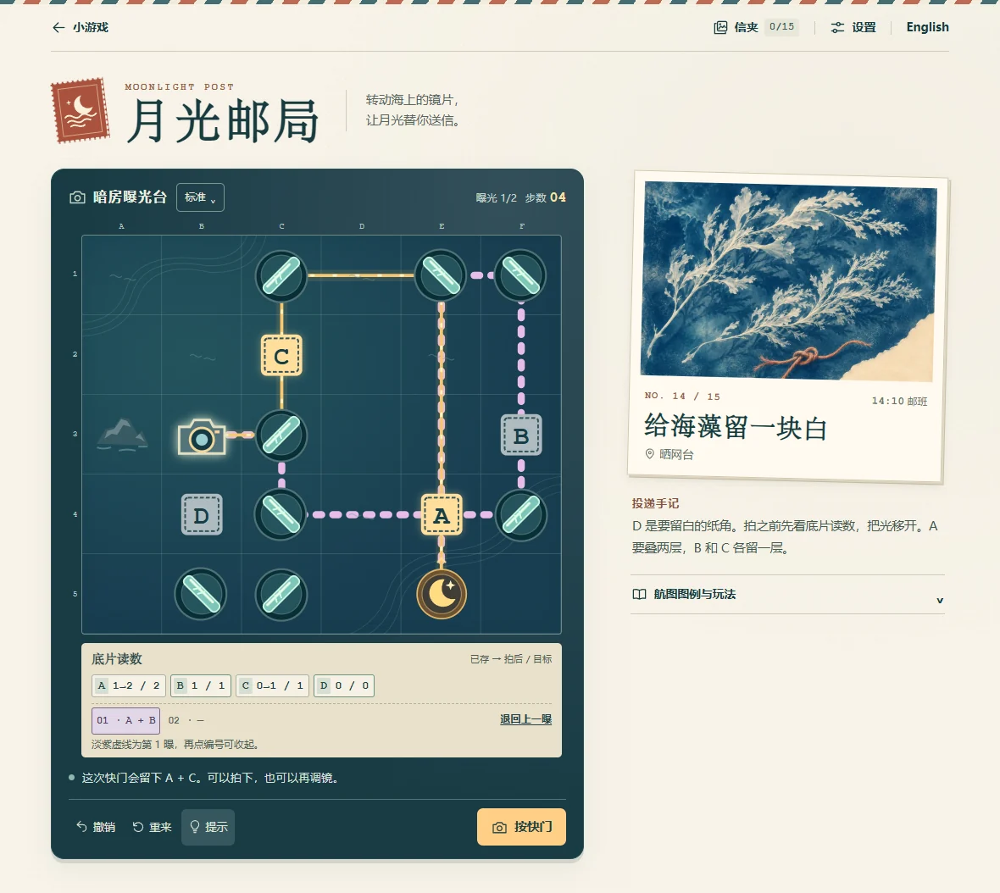

# 女友小游戏

`index.html` 是「隔空拍脸」的入口。点击头像即可玩，也可以开启摄像头，让漫画手掌跟随手部动作挥拍。

默认头像是发布时提供的照片。游玩时临时更换的照片只在当前页面使用。摄像头画面在浏览器内处理，切换到其他标签页时会关闭摄像头。素材、手部识别模型和运行时包含在站点里。

## 月光邮局

从首页顶部点「月光邮局」，或打开 [月光邮局](./moon-mail/index.html)。转动海上的圆镜，让月光经过沿途的邮戳、照到收信箱，再点「寄出月光」拆信。「沿海夜邮」的六封信从白沙灯塔一路寄到晨光窗台。「回信篇」从海角温室出发，经过风铃栈桥，抵达望海天文台。回信的编号邮戳要按数字顺序首次经过。

第三章「两岸合邮」从两座信号屋出发，经过雾钟渡口，在星湾转桥会合。前往「信夹 → 两岸合邮」或直接打开[本章第一站](./moon-mail/index.html#signals)。两束光共用镜片，金色实线送到月亮信箱，青色虚线送到星星信箱。点航图下的光路名称可以单独追踪其中一束。

「直投」接通两只信箱即可寄出。「合印」还需要两束光同时穿过菱形邮戳，每站都有另一条走法。成功投递后，票根背面会展开一段留言，导出明信片时也会印上。集齐同一难度的三枚合印，信夹里就能拼出两个人见面的约定。两种投递方式分别保存进度和最佳步数。

第四章「潮汐暗房」把海边的贝壳、海藻和两把椅子拍成三张明信片。转镜让光经过字母感光点、进入相机，按快门就能在同一张底片上存下一层。第二张要给纸角留白，第三张要安排三次曝光的先后。拍过的编号可以点开，在航图上用虚线对照当时的光路。底片和转镜都可以撤销。冲印后，明信片会附上你实际拍过的每一条光路。[试玩潮汐暗房](./moon-mail/index.html#shellprint)

点航图上的难度名或顶部「设置」即可换档。轻松档会先调好一部分镜片并标出下一步。标准档提供按需提示。挑战档每站都有独立的航图，须在最少步数内送达，撤销可以返还步数。各档独立保存路线、撤销记录与最佳步数。原版存档可在标准档继续。

顶部的语言按钮可随时切换简体中文和 English。设置内可试听、静音或调节音量。转镜、邮戳、潮门、寄送和拆信等声音由浏览器实时合成。键盘可用 Tab 选中镜片后按空格或回车旋转。「信夹」可以选关、重读、改写寄语并导出 PNG。自写的寄语在切换语言和难度后保留。

**English.** Open Moonlight Post and use the language button in the upper right. The album holds six coastal letters, three replies with numbered seals, and three paired deliveries in *Across the Bay*. Match the solid moon beam and dashed star beam to their own mailboxes. For a joint postmark, both beams must pass through the diamond on their way to the boxes. Each postmark reveals a handwritten clue. Collect all three in one difficulty to unfold the meeting plan. Select Relaxed, Standard or Expert on the chart. Every delivered card can be personalised and saved as a PNG.

The final three postcards are made in the *Tidewater Darkroom*. Take two or three exposures on the same negative. Match each lettered site's layer count, keeping any zero targets clear. Tap a recorded shot to compare its route with the live beam. The developed postcard includes a contact sheet of your exposures. Expert counts every mirror turn across the whole negative.

在仓库根目录运行 `node --test` 可验证全部关卡的光路、曝光组合、存档恢复与提示（Node.js 18 及以上）。

## GitHub Pages

将解压后的内容提交到目标仓库的发布分支根目录。在仓库 **Settings → Pages** 选择 **Deploy from a branch**，选对应分支和 **/(root)**。访问 GitHub Pages 提供的 HTTPS 地址使用摄像头。网页及资源路径支持发布在仓库子路径下。

本地开发也可以在该目录运行 `python -m http.server 8000`，然后访问 `http://localhost:8000/`。

## 实现

- `assets/game.js` 处理头像、分数和打击动画。
- `assets/camera.js` 处理相机权限、MediaPipe 推理和手部位置投影。
- `assets/hand-model.js` 根据手部节点绘制手掌轮廓、手指和光影。
- `assets/swipe.js` 根据掌心移动速度及轨迹与头像的接触判断挥拍。
- `assets/vision/` 包含 Google MediaPipe Tasks Vision 0.10.14、Hand Landmarker Float16 v1 模型及运行时代码的 Apache 2.0 许可文本。
- `assets/sound.js` 提供音效开关和打击音效。
