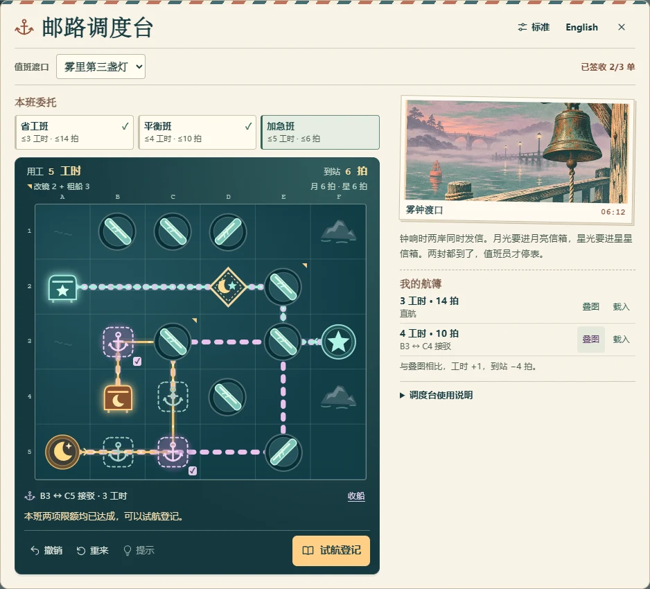

# 女友小游戏

`index.html` 是「隔空拍脸」的入口。点击头像即可玩，也可以开启摄像头，让漫画手掌跟随手部动作挥拍。

默认头像是发布时提供的照片。游玩时临时更换的照片只在当前页面使用。摄像头画面在浏览器内处理，切换到其他标签页时会关闭摄像头。素材、手部识别模型和运行时包含在站点里。

## 月光邮局

从首页顶部点「月光邮局」，或打开 [月光邮局](./moon-mail/index.html)。转动海上的圆镜，让月光经过沿途的邮戳、照到收信箱，再点「寄出月光」拆信。「沿海夜邮」的六封信从白沙灯塔一路寄到晨光窗台。「回信篇」从海角温室出发，经过风铃栈桥，抵达望海天文台。回信的编号邮戳要按数字顺序首次经过。

雨巷街角的**雨巷折笺**从屋檐下的一滴雨开始。沿两列或两行之间的直线把纸巾对折、轻压、摊开。相贴的纸格会互相转印。清雨碰到星戳会洇出朱墨，下一折才能把新墨带走。点任一水印，可以沿它经过的折痕追到最初的屋檐。[试玩雨巷折笺](./moon-mail/index.html#rain-folds)

日班有一对折笺共用前五折。最后先压 D│E 再压 3─4，信箱旁的 E3 会留清雨。交换这两折，全张纸只有 E3 换成朱印。夜班的六道痕每道只能用一次，可以让 B5、F5 两格都沾雨，也可以让 B5 收朱、F5 留白。从旧信能回到分岔处续印。同一组折痕确实印出两种窗色时，可以并排摊开两张，细看每一处差异。[看实机印出的日班对页](./docs/rain-lane-pair.webp)

堤岸暗房的**窗边三连照**让你亲手摆出信里的三张照片。先推藤椅拍一张远景，再推青木椅，在两把椅子之间留一格窗光。第三张要让它们挨在一起。选个方向，地板上的虚线会画出摄影人走到椅背的路。人能穿过帘门，每次按快门还得走得回相机。[试玩窗边三连照](./moon-mail/index.html#windowprint-three-frames)

日班第二张若拍在 D3 和 B3，最后可以把藤椅推一格填进空位，也可以绕到青木椅侧面，甚至换到它另一边。夜班的晾片架挡住了直接推近的站位，两种六推解直到最后一推才分开。点开旧底片就能从那一张续拍，拖动分界线还能对照两次取景。[看实际洗出的三连照](./docs/seawall-chair-portraits.webp)

晒网台的**海藻双联晒印**从信里那半枚指印开始。把带藻和鹿角藻夹在原图的圆夹眼上，留下首晒。第二次只能动其中一枝。两次都遮住的地方留白，只遮过一次的地方洗成浅蓝。四处校样晒色吻合，就能把自己的蓝晒印随信寄走。[试玩海藻双联晒印](./moon-mail/index.html#kelpprint-diptych)

想给这封信配一对图，可以从回信点「沿用这张首晒」。日班试着固定鹿角藻，让 A4 留白，换成固定带藻，白印会移到 B5。夜班的两处白印在上沿，同一枝鹿角藻在同一夹眼翻个面，就能调换它们。两页确实共用一张首晒时能合装，还可以拆开看每页的两次曝光，或选一页单独导出。[看实机晒出的双联页](./docs/net-drying-diptych.webp)

白沙灯塔的**余晖引航**让你在第一封信所说的第七闪靠岸。塔灯和两座浮标的灯面每闪一起转动，圆镜会让光转弯。每闪可以向相邻的亮格划一桨，或在灯旁系缆。船上有一瓶余晖，途中能用一次，划进上一闪还亮着的格子。点任意水格，就能查它整晚的灯历。[试玩余晖引航](./moon-mail/index.html#lighthouse-afterglow)

日班第四闪到 D2 后，可以系船等两闪，从南边进信箱。也可以趁 E2 的光刚灭，借余晖绕过 E1，从东边在同一闪靠岸。日班的六份灯历和夜班的五份灯历都能逐份收藏。翻开旧信可从最后一个共同闪次改走，每一闪还能把上次的小船叠回图上，看它当时等在哪儿、两趟从哪里分开。[查看白沙灯塔实机画面](./docs/white-sand-afterglow.webp)

星湾转桥的**双铃过桥**让明信片里那两辆自行车上了原来的航图。两辆车都要到桥心按铃，再把信送进各自的信箱。选车和方向就能预览它会沿哪些镜面拐弯、穿哪扇潮门、最后停在哪一格。车停在桥上时可以转桥，也可以让同伴等在下一处弯道，借它多停一站。[试玩双铃过桥](./moon-mail/index.html#bridge-bells)

日班有两条同为 8 步的解法，前 5 步完全相同。月铃车到 B4 后，可以转桥往南直接进 B5，也可以从桥上往东穿门，借等在 D5 的星铃车停在 C5，再从侧面投信。点「如果星铃车先走呢？」就能看到这段路原本会滑到哪里。路书分别记录三种骑法的个人最佳，还能保留通往另一种最短骑法的共同路段，从岔口接着试。挑战档沿用星湾夜图，独立停靠、单向借停、轮流借停各自最少需要 10、10、11 步。[查看星湾转桥实机画面](./docs/star-bay-bridge-bells.webp)

海角温室的**月光标本**把原来的两枚顺序花戳变成了接枝点。先让橙花开，再把它压到纸上。已经照过的镜子会被压住，你可以从花心、旧镜或枝条中段另抽一枝，照到风铃草，最后再把光接进信箱。两枝可以十字交叉，每条边只能用一次。[试玩月光标本](./moon-mail/index.html#glasshouse-herbarium)

日班的七种花样共用一组镜向。窗顶的两朵花压好后，从 C4 往北一格就能寄信，也可以从 D1 花心往东，沿东窗绕九格回来。夜图的对页观察则收两份总长同为八格的标本。标本夹能保留一朵或两朵接着试，寄出的明信片会印上自己种出的三段枝。轻松档会标出下一步，标准档按需提示，挑战档在夜图独立接枝。[查看海角温室实机画面](./docs/glasshouse-herbarium.webp)

双拱海峡的**回潮航带**把信装进发条纸船。给循环的纸带写下舵令，水面和星戳各读一拍，固定镜引导船头，穿拱会反转读带顺序。日班同一张图有两种走法恰好都用 11 格，只改星戳上读到的那一拍，就能选择立即掉头，或沿 E4、E5 的南堤绕回。挑战档换到原站夜图，可以试着穿一、两或三次拱再靠岸。[试玩回潮航带](./moon-mail/index.html#arches-reel)

试航滑块可以逐格回放，选中一拍就能看见它在哪些格子响过。反过来，点水格能找到当时的舵令，再点还能翻看小船第二次经过的情形。寄出后可借回那卷航带，在旧航迹上改一拍，看新旧小船最先从哪一格分开。明信片会印上实际航迹和舵令。[查看双拱海峡实机画面](./docs/twin-arch-reel.webp)

晨光窗台的**推窗早茶**让同一束光暖过两只茶杯，再抵达原来的信箱。横窗只能左右滑，升降窗只能上下滑，同框的两片镜一起移动、一起翻面。日班原图上，先暖蓝纹杯最短走 13 格，先暖橙花杯最短走 15 格。也可以从另一扇潮门先进，看看回窗的光会落在哪里。[试玩推窗早茶](./moon-mail/index.html#dawn-sashes)

试推之前可以留一张窗影。虚线会和正在调的晨光叠在一起，对调窗位还能取回每份摆法自己的撤销记录。日班图有 13 条实际投递路线，挑战图有 10 条。早餐便签记下各自寄过的最短光路，两杯的先后、潮门和实际走线都印在可保存的杯垫上。[查看窗台实机画面](./docs/morning-window.webp)

沿海夜邮的「山坡上的灯」可以切换到**橘坡分岔线**。四处方框道岔共用两片岔镜。点空位装镜，再点翻面，第三下取回。每次从相同的开班镜位出发，经过坡顶和坡脚两枚邮戳，把信投进同一个邮箱。先到哪枚戳、从哪一侧进站，都可能改变这趟拿到的车票。每档难度有四条实际可走的线路。[试玩橘坡分岔线](./moon-mail/index.html#funicular-switchbacks)

缆车票夹中的空票可以翻看线索，签过的票可以叠回航图，查看两条路从哪一格分开。想再试一趟就点回执里的「同图再寄一封」。标准模式可对选中的车票求助，专家模式沿用橘子坡的山顶航图。旧票的盖戳顺序、里程和车窗小记随时可以重读，也会随明信片一起导出。集齐四张，司机会送来一份回程礼物。[查看缆车票夹实机画面](./docs/hillside-switchbacks.webp)

回信篇的「风铃栈桥」还可以值**雾班**。从岸边选一盏灯，先沿纸图预测光会走到哪里，再发光听测。手簿记下两枚铃响起的次序和最后回光的一岸。有时两种镜向都能把光送到信箱，却只有一种会响铃。结合几盏岸灯的证词，把纸图画到只剩唯一的解释，再亲手修好真镜，让回信依次经过 1、2 号邮戳。[试玩雾班听测](./moon-mail/index.html#chimes-watch)

同一班可反复尝试更省听测或修镜的做法。换班会改变雾中的镜向，每班可单独续玩。静音时能读到全部回声。签收的交班条会附在风铃栈桥的明信片和导出图上，日常回信的草稿和最佳步数单独保存。[查看听测手簿实机画面](./docs/fog-watch.webp)

望海天文台的**一笔星图**把原图铺成描星纸。从原来的月光灯起笔，依次画过 1、2、3 号星戳再进信箱。圆环和星戳可以自由转弯，空白处只有一枚星钉可用。星线不能重走旧格，穿潮门算一步。选择亮框或用方向键续画，退格键可撤销。[试玩一笔星图](./moon-mail/index.html#observatory-atlas)

同一张日班图有 10 条不同的星线，挑战档夜图有 21 条。试试省下星钉、用 10 步投递，或绕去纸边看一颗小星。签收后可把旧图叠在航图上，从仍有新走法的岔口接着描。导出的明信片会印上你实际画出的线。[查看天文台实机画面](./docs/observatory-atlas.webp)

第三章「两岸合邮」从两座信号屋出发，经过雾钟渡口，在星湾转桥会合。前往「信夹 → 两岸合邮」或直接打开[本章第一站](./moon-mail/index.html#signals)。两束光共用镜片，金色实线送到月亮信箱，青色虚线送到星星信箱。点航图下的光路名称可以单独追踪其中一束。

第三章第一站可以切到**两岸同拍**。先转动原图的圆镜，把月信与星信都引到菱形邮戳。盖印后，出发钟归零。两封信各选一个方向，可以改拨一面镜，也可以让其中一封晚几拍启程。两封都进入自己的信箱，且到达拍数相同，才可寄出。[试玩两岸同拍](./moon-mail/index.html#signals-duet)

标准图上，月信绕岸走五格、星信等四拍走一格，两岸会在第五拍同亮。也可以让两封各走五格，同时出发。拖动灯谱的拍号能看见每封信在哪里等、走到哪一格。点「独听」可以单独追踪一束光，也可以合起来听两封信应答。已寄灯谱可随时取出试听，当前草稿会保留。轻松和标准图各有五种实际邮路，挑战图有四种。[查看实机灯谱](./docs/signal-duet.webp)

「直投」接通两只信箱即可寄出。「合印」还需要两束光同时穿过菱形邮戳，每站都有另一条走法。成功投递后，票根背面会展开一段留言，导出明信片时也会印上。集齐同一难度的三枚合印，信夹里就能拼出两个人见面的约定。两种投递方式分别保存进度和最佳步数。

第四章「潮汐暗房」把海边的贝壳、海藻和两把椅子拍成三张明信片。转镜让光经过字母感光点、进入相机，按快门就能在同一张底片上存下一层。第二张要给纸角留白，第三张要安排三次曝光的先后。拍过的编号可以点开，在航图上用虚线对照当时的光路。底片和转镜都可以撤销。冲印后，明信片会附上你实际拍过的每一条光路。[试玩潮汐暗房](./moon-mail/index.html#shellprint)

「邮路调度台」在末班渡船、雨巷里的邮戳、雾里第三盏灯复用已有的航图。从信夹进入，也可以在这三站的手记或回执上点「调度这条邮路」。转镜直航，或从四个锚形泊位中选两个租船接驳。每面偏离开班朝向的镜子计 1 工时，租船另计 3 工时。光走一格算一拍，接驳保持方向、瞬间过渡。雨巷仍要先盖邮戳，雾钟渡口以两封信中较晚的一封计时。[从末班渡船开始值班](./moon-mail/index.html#dispatch-ferry)

每张工单同时限定用工和到站时刻。雾钟渡口的标准图可以用 3 工时走 14 拍，也可以用 5 工时赶到第 6 拍。试航后，航簿会留住各有优势的送法。点「叠图」对照光路，点「载入」从旧方案接着改。签完一站的所有委托可以读到值班员的手记。三档难度分别保存航簿和草稿。

点航图上的难度名或顶部「设置」即可换档。日常投递的轻松档会先调好一部分镜片并标出下一步，标准档提供按需提示，挑战档要在本站的另一张航图上以最少步数送达。各专门邮班的难度说明也在这里。回潮航带的轻松档铆定两拍并标出建议舵令，标准档可以问一步提示，挑战档独立编七拍。各档分别保存进度，原版存档可在标准档继续。

顶部的语言按钮可随时切换简体中文和 English。设置内可试听、静音或调节音量。转镜、邮戳、潮门、寄送和拆信等声音由浏览器实时合成。键盘可用 Tab 选中镜片后按空格或回车旋转。「信夹」可以选关、重读、改写寄语并导出 PNG。自写的寄语在切换语言和难度后保留。

**English.** Open Moonlight Post and use the language button in the upper right. The album holds six coastal letters, three replies with numbered seals, and three paired deliveries in *Across the Bay*. Match the solid moon beam and dashed star beam to their own mailboxes. For a joint postmark, both beams must pass through the diamond on their way to the boxes. Each postmark reveals a handwritten clue. Collect all three in one difficulty to unfold the meeting plan. Select Relaxed, Standard or Expert on the chart. Every delivered card can be personalised and saved as a PNG.

The final three postcards are made in the *Tidewater Darkroom*. Take two or three exposures on the same negative. Match each lettered site's layer count, keeping any zero targets clear. Tap a recorded shot to compare its route with the live beam. The developed postcard includes a contact sheet of your exposures. Expert counts every mirror turn across the whole negative.

Open the **Dispatch desk** in the album to revisit The Last Ferry, A Postmark in the Rain and The Third Lamp. Charter a crossing between any two anchors or sail direct. A changed mirror costs one crew-hour, a charter costs three more, and a ferry crossing takes zero beats. Try the same delivery on a smaller crew or an earlier schedule. Log a sailing, overlay it on your next attempt, or reload it to explore another tradeoff. Sign every work order at a station to read the keeper’s note.

At **Wind Chime Pier**, select **Fog Watch**. Call from a shore lamp, compare the bells and return shore with your pencil forecast, and deduce the hidden mirror angles. After verification, repair the actual mail route and deliver the reply through both numbered bells. Each watch can be revisited with the same evidence problem. The album counts the pier once and keeps its handover slip with the postcard. All audible clues are also written in the listening log.

At **Orange Hill Station**, choose **Hillside Switchbacks**. Fit, flip or lift two switch mirrors across four square sockets. Each difficulty has four distinct ways to collect both stamps and reach the same box from the same start. Select an unissued ticket for a clue or an issued ticket to overlay its actual route. Each ticket comes with a note from the journey.

At **Star Bay**, open **Bridge Bells**. Ring each bike’s bell on the swing bridge, then post at its matching box. A waiting bike can give the other rider a new place to stop. Two eight-move rides share their first five moves. At B4, turn the deck and ride straight into B5, or keep it facing east, coast through the gate and borrow a stop at C5. Each page keeps your best ride. Reopen a posted slip at the last fork on a shortest route to another page. [Play Bridge Bells](./moon-mail/index.html#bridge-bells)

At **Rain Lane**, make **Rain Prints** with the spare napkin from the letter. Press a crease, reopen the paper, and see which squares touched. Bring the first drop to the star to wake its red ink, then print the envelope. Tap a mark to trace its journey. Two daylight letters share their first five presses and use the same last two creases in reverse order. Only E3 changes, from blue rain to red ink. Reopen a posted letter at the fork. Once both prints are filed, hold them side by side or export the pair. [Play Rain Prints](./moon-mail/index.html#rain-folds)

At **Seawall Darkroom**, take **Three Frames by the Window**. Move the wicker chair for the wide shot, then the slatted chair to leave one patch of light between them. For the last frame, close that gap, turn the corner or take the long way round to trade places. Each shutter requires a walk back to the camera. On the night floor a drying rack blocks the obvious push, and two six-push solutions share every move until the last. Reopen a negative to pick up from that exposure and slide the divider to compare your two photographs. [Play Three Frames by the Window](./moon-mail/index.html#windowprint-three-frames)

At the **Net-Drying Terrace**, make **Seaweed Diptychs** with a ribbon and a forked frond. Pin both on the original chart for a first exposure, then move or turn one specimen. Shade twice for paper white, once for pale blue. Match the four registration marks to post a print. Reuse its first exposure to make a companion with the margin tones reversed. The album binds the two pages and lets you inspect or export either one on its own. [Play Seaweed Diptychs](./moon-mail/index.html#kelpprint-diptych)

At **White Sand Light**, try **Afterglow Passage**. Row on the sweeping lights or wait at a beacon. Once per crossing, a bottled afterglow will carry you onto a square that was lit one flash ago. At D2 on the fourth daytime flash, wait twice for a short approach, or spend the bottle to circle the outer bay. Both letters reach the same box on flash seven. Inspect any square’s light table, rewind a flash, or overlay a posted crossing to see exactly where the wakes part. [Play Afterglow Passage](./moon-mail/index.html#lighthouse-afterglow)

At **Cape Glasshouse**, open **Moonlit Herbarium**. Press the orange blossom to keep its stem and the mirrors it touched. Grow a second shoot to the bellflower, then take a cutting from either stem to reach the mailbox. The two daytime study pages keep the very same flowers but send the final shoot one or nine squares. The night pages make two different eight-square impressions. Keep one or both flowers from a filed specimen to try another ending.

At **Twin Arch Strait**, choose **The Tide Reel**. Write helm orders for a clockwork paper boat. Water and the stamp advance the reel, fixed mirrors turn the bow, and each arch reverses the reading direction. Tap a square to find the beat that sent the boat there, then tap again to inspect a later visit. Two different eleven-step deliveries part at the stamp on F4. Borrow a filed reel to explore that fork. The seven-beat night chart has landings after one, two or three crossings.

At **Twin Signal Huts**, choose **Signal Duet**. Gather both letters at the diamond desk, then aim each one, change up to one mirror, and set a departure gap. Each cell takes one beat. Both boxes must light on the same beat. Scrub the two-part score to see where the letters waited or travelled, play their two voices, or listen to a filed score while your rehearsal stays on the desk.

At **The Morning Window**, choose **Tea at the Window**. Slide a frame one square along its track, or tap a mirror to tilt the panes sharing its frame. Warm both cups and reach the same mailbox. Keep a tracing before experimenting and swap the two settings to compare their paths. A filed coaster prints the actual route and the order in which the cups warmed.

在仓库根目录运行 `node --test` 可验证各关光路、曝光组合、调度委托、雾班线索、橘坡走法、两岸同拍的双信时序、一笔星图的岔口、推窗早茶的窗位、回潮航带的逐格航迹、月光标本的接枝与对页、双铃过桥的借停与最短分路、余晖引航的逐闪照明与靠岸航迹、海藻双联晒印的全纸晒色与共同首晒、窗边三连照的摄影站位与最短推数、雨巷折笺的逐格转印与墨迹来路，以及存档恢复与提示（Node.js 18 及以上）。

## GitHub Pages

将解压后的内容提交到目标仓库的发布分支根目录。在仓库 **Settings → Pages** 选择 **Deploy from a branch**，选对应分支和 **/(root)**。访问 GitHub Pages 提供的 HTTPS 地址使用摄像头。网页及资源路径支持发布在仓库子路径下。

本地开发也可以在该目录运行 `python -m http.server 8000`，然后访问 `http://localhost:8000/`。

## 实现

- `assets/game.js` 处理头像、分数和打击动画。
- `assets/camera.js` 处理相机权限、MediaPipe 推理和手部位置投影。
- `assets/hand-model.js` 根据手部节点绘制手掌轮廓、手指和光影。
- `assets/swipe.js` 根据掌心移动速度及轨迹与头像的接触判断挥拍。
- `assets/vision/` 包含 Google MediaPipe Tasks Vision 0.10.14、Hand Landmarker Float16 v1 模型及运行时代码的 Apache 2.0 许可文本。
- `assets/sound.js` 提供音效开关和打击音效。
